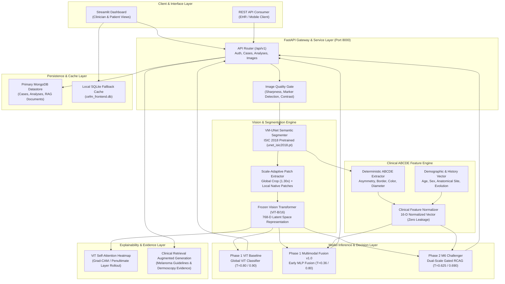

# CEFM — Complete Architecture Documentation

**Document ID:** `CEFM-ARCH-DOC-2026-11-07`  
**System Name:** Cross-Modal Explainable Framework for Melanoma Assessment (CEFM)  
**Architecture Version:** 2.0 (Dual-Scale Multimodal with RCAG Challenger Integration)  

---

## 1. Architectural Overview & System Topology

CEFM is an asynchronous, multi-tiered clinical AI platform designed for fine-grained dermoscopic lesion analysis, risk stratification, and structured explainable reporting. It combines vision transformers, semantic segmentation, computer vision ABCDE feature extraction, and residual-gated multimodal fusion.



---

## 2. Core Subsystems & Components

### 2.1 Image Preprocessing & Semantic Segmentation
- **Quality Gate (`app/services/image_validation.py`):** Rejects blurred images, uncalibrated ruler artifacts, and non-dermatological inputs.
- **Lesion Segmentation (`app/services/segmentation.py`):**
  - Model: Fully convolutional UNet trained on ISIC 2018 Task 1 (`models/segmentation/unet_isic2018.pt`).
  - Output: Binary mask ($M \in \{0, 1\}^{H \times W}$) delineating lesion boundary.
  - Fallback: Morphological Otsu thresholding when neural segmentation produces degenerate masks ($<0.5\%$ or $>95\%$ image area).

### 2.2 Dual-Scale Visual Feature Extraction (`app/services/dual_scale.py`)
- **Global Context View ($v_{\text{global}}$):**
  - Extracts lesion centroid $(c_x, c_y)$ and bounding dimension $S = 1.30 \times \max(w_{\text{lesion}}, h_{\text{lesion}})$.
  - Crops square ROI and resizes via bicubic interpolation to $224 \times 224 \times 3$.
  - Encodes through ViT backbone to produce 768-D global latent representation.
- **Local High-Resolution View ($v_{\text{local}}$):**
  - Operates on uncompressed native-scale image coordinates.
  - For lesions $\le 224\text{ px}$, extracts a single centered $224 \times 224$ crop.
  - For lesions $> 224\text{ px}$, tiles multiple overlapping $224 \times 224$ crops along high-gradient lesion margins (stride: $112\text{ px}$).
  - Embeddings aggregated via masked average pooling:
    $$\bar{v}_{\text{local}} = \frac{1}{K} \sum_{k=1}^K v_{\text{local}}^{(k)}$$

### 2.3 Clinical ABCDE Feature Vectorization (`app/services/abcde/vector.py`)
The 16-dimensional clinical feature vector $x_{\text{clin}} \in \mathbb{R}^{16}$ is constructed deterministically:
1. $x_0$: Area asymmetry score ($0.0$ to $1.0$).
2. $x_1$: Major-axis perimeter asymmetry.
3. $x_2$: Minor-axis perimeter asymmetry.
4. $x_3$: Normalized border compactness ($P^2 / (4\pi A)$).
5. $x_4$: Border fractal dimension / structural irregularity.
6. $x_5$: HSV hue entropy.
7. $x_6$: HSV saturation standard deviation.
8. $x_7$: Value / brightness contrast ratio.
9. $x_8$: Number of distinct color clusters present ($1$ to $6$).
10. $x_9$: Calibrated lesion maximum diameter (mm) or pixel proxy.
11. $x_{10}$: Normalized patient age (years $/ 100.0$).
12. $x_{11}$: Patient sex (Binary: Male = 1, Female = 0).
13. $x_{12}$: Anatomical site: Torso/Trunk.
14. $x_{13}$: Anatomical site: Extremities.
15. $x_{14}$: Anatomical site: Head / Neck.
16. $x_{15}$: Longitudinal evolution index (change in area/border over time).

### 2.4 Residual Cross-Attention Gated Multimodal Fusion (RCAG — M6)
The M6 Challenger architecture (`app/ml/multimodal/dual_scale_models.py`):
1. **Cross-Scale Feature Gating:**
   $$g_{\text{scale}} = \sigma\left(W_g [v_{\text{global}} \,\|\, v_{\text{local}}] + b_g\right)$$
   $$v_{\text{fused}} = g_{\text{scale}} \odot v_{\text{global}} + (1 - g_{\text{scale}}) \odot v_{\text{local}}$$
2. **Clinical Residual Modulation:**
   $$h_{\text{clin}} = \text{ReLU}\left(W_c \cdot \hat{x}_{\text{clin}} + b_c\right)$$
   $$\alpha_{\text{mod}} = \sigma\left(W_{\alpha} \cdot h_{\text{clin}} + b_{\alpha}\right)$$
   $$z_{\text{multimodal}} = v_{\text{fused}} + \alpha_{\text{mod}} \odot \left(W_m h_{\text{clin}}\right)$$
3. **Classification Head:**
   $$P(\text{Melanoma}) = \text{Softmax}\left(W_{\text{cls}} z_{\text{multimodal}} + b_{\text{cls}}\right)_1$$

---

## 3. Data Contracts & API Schemas

### Request Schema (`POST /api/v1/analyze`)
```json
{
  "image": "multipart/form-data (JPEG/PNG/BMP)",
  "patient_id": "string (optional)",
  "lesion_id": "string (optional)",
  "age": "integer (optional)",
  "sex": "string: male | female | unknown (optional)",
  "anatomical_site": "string: torso | extremity | head_neck | other (optional)",
  "evolution_history": "object (optional)",
  "ruler_calibration_mm": "float (optional)"
}
```

### Response Schema (`POST /api/v1/analyze`)
```json
{
  "analysis_id": "string (UUID)",
  "timestamp": "ISO-8601 UTC string",
  "image_quality": {
    "status": "passed | rejected",
    "sharpness_score": "float",
    "ruler_detected": "boolean"
  },
  "segmentation": {
    "mask_url": "/api/v1/images/{id}/segmentation",
    "lesion_area_pixels": "integer",
    "perimeter_pixels": "float"
  },
  "abcde_features": {
    "asymmetry": "float [0.0 - 1.0]",
    "border_irregularity": "float [0.0 - 1.0]",
    "color_diversity_index": "integer [1 - 6]",
    "max_diameter_mm": "float or null"
  },
  "production_baseline": {
    "vit_melanoma_probability": "float [0.0 - 1.0]",
    "vit_decision_threshold": 0.800,
    "vit_predicted_class": "mel | non_mel",
    "multimodal_melanoma_probability": "float [0.0 - 1.0]",
    "multimodal_decision_threshold": 0.360,
    "multimodal_predicted_class": "mel | non_mel"
  },
  "challenger_m6": {
    "challenger_model_id": "M6",
    "challenger_architecture": "GatedDualScaleFusion (RCAG)",
    "melanoma_probability": "float [0.0 - 1.0]",
    "operating_point_f1": {
      "threshold": 0.690,
      "predicted_class": "mel | non_mel",
      "margin_to_threshold": "float"
    },
    "operating_point_screening_spec": {
      "threshold": 0.625,
      "predicted_class": "mel | non_mel",
      "margin_to_threshold": "float"
    },
    "local_patch_count": "integer"
  },
  "explainability": {
    "attention_map_url": "/api/v1/images/{id}/attention",
    "clinical_discordance_alert": "boolean",
    "discordance_reasoning": "string or null"
  }
}
```

