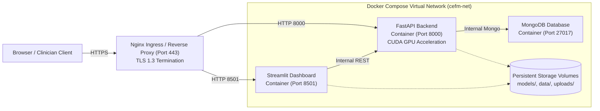

# CEFM — Production Deployment Guide

**Document ID:** `CEFM-DEPLOY-GUIDE-2026-11-07`  
**Platform:** Cross-Modal Explainable Framework for Melanoma Assessment  
**Target Environments:** Cloud GPU (AWS EC2 g5.xlarge, GCP a2-highgpu-1g, Azure NVadsA10v5) or On-Premises Clinical Workstation  

---

## 1. System Requirements

### Hardware Requirements
| Component | Minimum Specification | Recommended Specification |
| :--- | :--- | :--- |
| **Processor** | 4-Core x86_64 CPU | 8-Core x86_64 CPU (Intel Xeon / AMD EPYC) |
| **System Memory (RAM)** | 16 GB DDR4 | 32 GB DDR4/DDR5 |
| **Accelerator (GPU)** | CPU Execution Supported | NVIDIA GPU (T4, A10, RTX 3080+, 8GB+ VRAM, CUDA 11.8+) |
| **Storage** | 20 GB SSD | 50 GB NVMe SSD |
| **Network** | 100 Mbps Ethernet | 1 Gbps Dedicated Link |

### Software Dependencies
- Operating System: Ubuntu 22.04 LTS, Debian 12, or Windows Server 2022
- Container Engine: Docker Engine 24.0+ & Docker Compose v2.20+
- GPU Container Toolkit: NVIDIA Container Toolkit (`nvidia-ctk`)
- Python Runtime (Local / Non-Docker): Python 3.10+

---

## 2. Containerized Deployment Architecture



---

## 3. Production Docker Specifications

### 3.1 Backend Dockerfile (`deploy/backend.Dockerfile`)
```dockerfile
FROM nvidia/cuda:11.8.0-runtime-ubuntu22.04

ENV DEBIAN_FRONTEND=noninteractive \
    PYTHONUNBUFFERED=1 \
    PYTHONDONTWRITEBYTECODE=1

RUN apt-get update && apt-get install -y --no-install-recommends \
    python3.10 python3-pip python3.10-dev \
    libgl1-mesa-glx libglib2.0-0 \
    curl build-essential \
    && rm -rf /var/lib/apt/lists/*

RUN ln -s /usr/bin/python3.10 /usr/bin/python

WORKDIR /app

COPY requirements.txt .
RUN pip install --no-cache-dir --upgrade pip && \
    pip install --no-cache-dir -r requirements.txt

COPY app/ app/
COPY models/ models/

EXPOSE 8000

HEALTHCHECK --interval=30s --timeout=5s --start-period=60s --retries=3 \
  CMD curl -f http://localhost:8000/api/v1/health || exit 1

CMD ["uvicorn", "app.main:app", "--host", "0.0.0.0", "--port", "8000", "--workers", "2"]
```

### 3.2 Frontend Dockerfile (`deploy/frontend.Dockerfile`)
```dockerfile
FROM python:3.10-slim

ENV PYTHONUNBUFFERED=1 \
    PYTHONDONTWRITEBYTECODE=1

WORKDIR /app

COPY requirements-streamlit.txt .
RUN pip install --no-cache-dir -r requirements-streamlit.txt

COPY streamlit_app1.py .
COPY app/ app/

EXPOSE 8501

HEALTHCHECK --interval=30s --timeout=5s --start-period=30s --retries=3 \
  CMD curl -f http://localhost:8501/_stcore/health || exit 1

CMD ["streamlit", "run", "streamlit_app1.py", "--server.port=8501", "--server.address=0.0.0.0", "--server.enableCORS=false"]
```

### 3.3 Docker Compose Configuration (`docker-compose.yml`)
```yaml
version: '3.8'

services:
  mongodb:
    image: mongo:6.0
    container_name: cefm-mongodb
    restart: always
    environment:
      MONGO_INITDB_DATABASE: cefm_melanoma
    volumes:
      - mongo-data:/data/db
    networks:
      - cefm-net

  backend:
    build:
      context: .
      dockerfile: deploy/backend.Dockerfile
    container_name: cefm-backend
    restart: always
    environment:
      - MONGODB_URL=mongodb://mongodb:27017
      - MONGODB_DATABASE=cefm_melanoma
      - DEEPSEEK_API_KEY=${DEEPSEEK_API_KEY}
    volumes:
      - ./models:/app/models:ro
      - ./uploads:/app/uploads
    ports:
      - "8000:8000"
    deploy:
      resources:
        reservations:
          devices:
            - driver: nvidia
              count: all
              capabilities: [gpu]
    depends_on:
      - mongodb
    networks:
      - cefm-net

  frontend:
    build:
      context: .
      dockerfile: deploy/frontend.Dockerfile
    container_name: cefm-frontend
    restart: always
    environment:
      - API_URL=http://backend:8000/api/v1
    ports:
      - "8501:8501"
    depends_on:
      - backend
    networks:
      - cefm-net

volumes:
  mongo-data:

networks:
  cefm-net:
    driver: bridge
```

---

## 4. Production Checklist & Environment Variables

### Environment Variables (`.env.production`)
```bash
# Model Execution Flags
ENABLE_CHALLENGER_M6=true
CHALLENGER_M6_OPERATING_POINT=screening_spec  # or f1_optimal

# External LLM / RAG APIs
DEEPSEEK_API_KEY=your_secured_production_key_here
DEEPSEEK_API_URL=https://api.deepseek.com/v1/chat/completions
DEEPSEEK_MODEL=deepseek-chat

# Database Configuration
MONGODB_URL=mongodb://mongodb:27017
MONGODB_DATABASE=cefm_melanoma

# Security
SECRET_KEY=generate_cryptographically_secure_random_key_here
ALLOWED_ORIGINS=https://cefm.yourclinicaldomain.org
```

### Pre-Deployment Verification Protocol
1. **Model Checkpoint Hash Audit:** Execute `python scripts/audit_checkpoint_hashes.py` to confirm SHA-256 match.
2. **Health Probe:** Verify `GET /api/v1/health` returns `{"status": "ok", "models": {"vit": true, "unet": true, "multimodal": true, "m6": true}}`.
3. **Automated Regression Suite:** Run `pytest tests/ -v` (confirm 79/79 pass).
4. **Shadow Deployment Monitoring:** Log all comparative predictions between Phase 1 Production Baseline and M6 Challenger into `cases_collection` for clinical governance audit.

