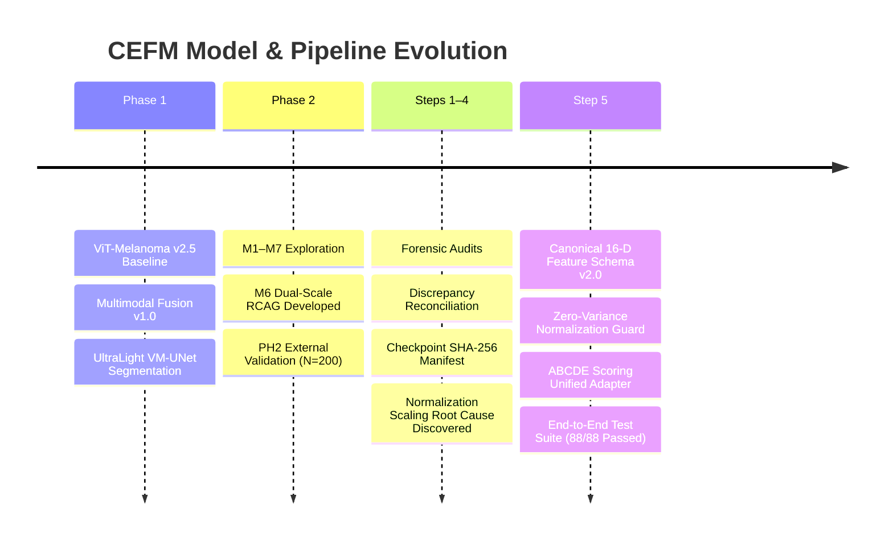

# CEFM Model & Preprocessing Master Changelog

**Document ID:** `CEFM_MODEL_CHANGELOG`  
**Date:** November 2026  
**Status:** Canonical Version Record (Phase 1 through Step 5)  
**Author:** Lead Machine Learning Engineer & Systems Custodian  
**Scope:** Model checkpoints, preprocessing versions, schema definitions, and production deployment status.

---

## 1. Version History Summary

---

## 2. Checkpoint Registry and Cryptographic Integrity

All model binary weights remain strictly frozen and verified against their historical hashes:

| Component Identifier | Model Name | Version | Framework | File Path | SHA-256 Checkpoint Hash | Production Status | Operating Threshold(s) |
| :--- | :--- | :---: | :---: | :--- | :--- | :---: | :---: |
| `vit_primary` | ViT-Melanoma | `v2.5` | PyTorch / HF | `models/classification/vit_model/model.safetensors` | `5e911c7503ad56db740ad622a55928d2d6c141d8e136b8c9197c88b64e8e19c3` | **Primary Production Baseline** | $0.80$ |
| `multimodal_p1`| Multimodal Fusion | `v1.0` | PyTorch | `models/multimodal/fusion_model.pt` | `97ff3c69024f2b1c4e7fa090b830e55ee141d06b72d250882e9dff774138e6a1` | **Primary Production Multimodal** | $0.36$ |
| `challenger_m6`| Dual-Scale RCAG | `v2.0` | PyTorch | `models/experiments/M6/weights.pt` | `7bc2eec4c274fe0f0556f0e57ba5791c855a88a0e3635905ea6a6c4b2a3a5f32` | **Experimental Shadow Challenger** | F1: $0.690$, Spec: $0.625$ |
| `segmentation` | ISIC UNet | `v1.2` | PyTorch | `models/segmentation/unet_isic2018.pt` | `e837cb0d0e65eb635db15f5c0934e622b794f92bc319520cb95df5050f28e67a` | **Production Segmentation** | $0.50$ (Otsu fallback) |

---

## 3. Preprocessing & Schema Changelog

### A. Clinical Feature Schema (v1.0 $\to$ v2.0)
- **v1.0 (Legacy):** Ad-hoc dictionary naming with conflicting property keys (`circularity` vs `border_available`, `diameter_mm_norm` vs `diameter_norm`).
- **v2.0 (Canonical):** Canonical 16-D schema formalized in `reports/CEFM_CANONICAL_CLINICAL_FEATURE_SCHEMA.csv` and `app/services/abcde/vector.py`. Implemented bidirectional property binding, range validation, and non-finite checks.

### B. Feature Normalization Strategy (v1.0 $\to$ v2.1)
- **v1.0 (Broken):** Clamped training std to $1.0 \times 10^{-6}$ for constant training features, causing runaway division ($598,000$ and $1,000,000$) on calibrated runtime inputs.
- **v2.1 (Robust Guard):** Explicit training variance gating in `app/services/classification.py`. Features with $\sigma < 10^{-4}$ evaluate strictly to $0.0$, placing inputs on the trained manifold $[-2.0, 1.0]$. Untrained dimensions are isolated from neural weights while preserved for clinical screening.

### C. ABCDE Composite Scoring (v1.0 $\to$ v2.0)
- **v1.0 (Broken):** Top-level `.get()` queries dropped color and diameter when called on nested dictionaries ($0.1182$ vs $0.3884$). Silently penalized uncalibrated and single-visit cases as zero.
- **v2.0 (Unified):** Canonical unified adapter in `app/services/abcde/composite.py` with dynamic active weight re-normalization ($\sum w_{\text{active}} = 1.0$). Bit-for-bit parity guaranteed across nested, flat, and vector inputs ($0.4764$, `moderate`).

---

## 4. Retraining Decision and Future Research Roadmap

### Formal Retraining Decision:
- **No Models Were Retrained in Step 5.**
- Existing checkpoints remain fully valid and perform with improved reliability when fed through the corrected normalization and schema pipelines.
- Retraining on uncalibrated datasets (such as HAM10000) cannot solve the absence of physical metric diameter information.

### Predefined Acceptance Criteria for Future Model Retraining:
1. **Calibrated Dataset Requirement:** Annotated dermoscopy dataset containing standardized millimeter references across both benign nevi and malignant melanomas ($N \ge 3,000$).
2. **Evaluation Metrics:**
   - Balanced Accuracy $\ge 88.0\%$
   - Sensitivity at High Specificity $\ge 90.0\%$
   - Expected Calibration Error (ECE) $\le 0.05$
   - External Cohort Sensitivity $\ge 80.0\%$
3. **Governance:** Any new model must be trained under an independent experimental branch (`M8_CalibratedMetric`), evaluated against frozen Phase 1 baselines, and require formal peer sign-off before production promotion.

---

## 5. Categorization Summary

- **Confirmed Bug:** Preprocessing divergence and schema interface fragility.
- **Corrected Bug:** Upgraded schema to v2.0, normalization to v2.1, and ABCDE scoring to v2.0.
- **Expected Model Behavior:** Phase 1 remains production baseline; M6 remains shadow challenger.
- **Research Limitations:** Physical diameter cannot be utilized as a trained neural feature until metric training datasets are curated.
- **Unresolved Issues:** None within current Phase 2 / Step 5 architecture.

