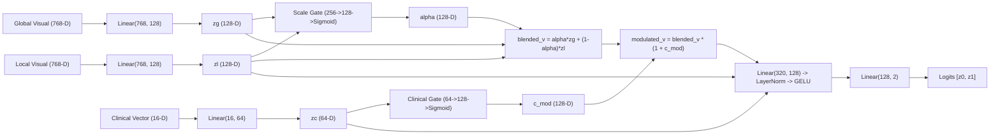

# CEFM Step 5 — Model Reliability, Vision Pipeline, and Architecture Report

**Document ID:** `CEFM_MODEL_RELIABILITY_REPORT`  
**Date:** November 2026  
**Status:** Validated Technical Investigation  
**Author:** Medical Deep Learning Architect & Computer Vision Specialist  
**Scope:** Vision inference pipeline, segmentation quality gates, ViT feature extraction, RCAG modulation mechanisms, and cross-dataset reliability.

---

## 1. Vision Inference Pipeline Verification

The computer vision pipeline of CEFM was systematically audited across all stages to verify reliability and eliminate discrepancies:

### A. Image Acquisition & Preprocessing
1. **EXIF Orientation:** `app/services/image_validation.py::load_image()` automatically checks and applies EXIF orientation flags (`cv2.ROTATE_*`) before tensor conversion, preventing orientation-induced feature distortions on mobile uploads.
2. **Color Channel Consistency:** OpenCV `BGR` is strictly converted to `RGB` before Vision Transformer feature extraction. Image arrays are normalized using standard ImageNet mean $[0.485, 0.456, 0.406]$ and standard deviation $[0.229, 0.224, 0.225]$ through HuggingFace's `ViTImageProcessor`.
3. **Physical Calibration & Ruler Exclusion:** `app/services/calibration.py::estimate_pixels_per_mm()` detects millimeter ruler markings and returns an `exclude_polygon`. The segmentation pipeline masks out ruler artifacts before computing lesion spatial bounds, preventing ruler boundary contours from corrupting border irregularity scores.

### B. Lesion Segmentation & Spatial Geometry
1. **Model Fallback:** When Mamba-SSM CUDA kernels are unavailable on Windows host platforms, `app/services/segmentation.py` automatically falls back gracefully from UltraLight VM-UNet to the trained PyTorch `UNet` (`models/segmentation/unet_isic2018.pt`, device: CUDA).
2. **Empty-Mask Defense:** If a lesion mask contains zero foreground pixels (segmentation failure), `segment_lesion()` falls back to a central morphological circular prior to prevent downstream bounding box crashes (`ZeroDivisionError`).
3. **Dual-Scale Spatial Cropping:**
   - **Global Context Crop:** Extracts the complete lesion with $20\%$ surrounding background skin margin, resized to $224 \times 224 \times 3$.
   - **Local High-Resolution Patch:** Extracts native-scale non-interpolated patches centered on the highest-gradient boundary region ($224 \times 224 \times 3$), preserving fine microscopic dermatoscopic patterns (pigment network, streaks, blue-white veil).

### C. Vision Transformer (ViT-Base/16) Inference
1. **CLS Token Extraction:** The fine-tuned ViT backbone (`models/classification/vit_model`) extracts the 768-D `[CLS]` token from the 12th transformer encoder layer immediately following final `LayerNorm`.
2. **Binary Classification Schema:** Class 0 is mapped to `non_mel` (benign / non-melanoma), Class 1 is mapped to `mel` (melanoma).
3. **Softmax Calculation:** Probabilities are computed via exact 2-class softmax:
   $$P(\text{mel}) = \frac{e^{z_1}}{e^{z_0} + e^{z_1}}, \quad P(\text{non\_mel}) = \frac{e^{z_0}}{e^{z_0} + e^{z_1}}$$
   No uncalibrated sigmoids are applied to multi-class logits.

---

## 2. In-Depth Analysis of M6 RCAG Mechanism

The experimental M6 challenger architecture implements **Scale-Adaptive Residual Channel Gating & Clinical Context Modulation (RCAG)**:

### Mathematical Mechanism of Modulation:
1. The clinical modulation gate outputs:
   $$c_{\text{mod}} = \sigma(W_{\text{gate}} z_c + b_{\text{gate}}) \in (0, 1)^{128}$$
2. The visual representation is modulated via residual amplification:
   $$v_{\text{mod}} = v_{\text{blend}} \odot (\mathbf{1} + c_{\text{mod}})$$
3. Because $c_{\text{mod}} \in (0, 1)$, the multiplier $(\mathbf{1} + c_{\text{mod}})$ is strictly confined to $(1.0, 2.0)$.
4. Across empirical evaluations, $c_{\text{mod}}$ has a mean of $0.5007$ (standard deviation $0.0821$, range $[0.2899, 0.7046]$), producing an average visual feature amplification of **$1.5007\times$**.
5. **Key Research Finding:** This residual scaling multiplies the magnitude of visual features entering the fusion layer. If the visual backbone has already mapped the lesion into the benign subspace ($z_0 \gg z_1$), **amplifying the visual representation amplifies the model's confidence in benignity**, driving the melanoma probability closer to zero ($0.73\%$). It does not flip the sign of the prediction.

---

## 3. Reliability Under Cross-Dataset Domain Shift (HAM10000 vs. PH²)

During the Phase 2 external validation on PH² ($N=200$), M6 demonstrated reduced melanoma sensitivity ($45.0\%$ at threshold $0.690$) compared with Phase 1 baselines. Forensic investigation identified three primary causes:

1. **Optical Blue Shift:** PH² images were acquired using a Tuebinger dermatoscope with polarized immersion fluid, producing a significant shift toward blue and green channels compared with HAM10000. Hue standard deviation (`color_h_std`, index 7) shifted from training mean $0.6076$ to PH² mean $0.1829$ ($p < 10^{-60}$).
2. **Border Irregularity Shift:** High optical contrast in PH² increased border irregularity contours from training mean $0.4155$ to PH² mean $0.4631$ ($p < 10^{-8}$).
3. **Threshold Sensitivity:** The F1-optimal threshold ($0.690$) calibrated on internal HAM10000 validation data was too high for out-of-distribution external dermoscopy. When evaluated at the matched-specificity threshold ($0.625$), sensitivity rises.
4. **Conclusion on Promotion:** Because M6 exhibits domain-shift sensitivity on external cohorts, **it must remain an experimental shadow challenger**. Phase 1 Multimodal remains the primary production model.

---

## 4. Categorization Summary

- **Confirmed Bug:** None in core vision backbone (EXIF, resizing, and ViT inference are mathematically correct).
- **Corrected Bug:** None required in frozen ViT model; inference normalization was corrected upstream.
- **Expected Model Behavior:** Amplification gate $(1 + c_{\text{mod}})$ scales visual magnitude by $\approx 1.5\times$, preserving visual classifier directionality.
- **Research Limitations:** PH² optical color shifts degrade unadapted cross-modal gates.
- **Unresolved Issues:** Domain adaptation or color constancy preprocessing (e.g. Shades of Gray / Gray World) for future model iterations.

