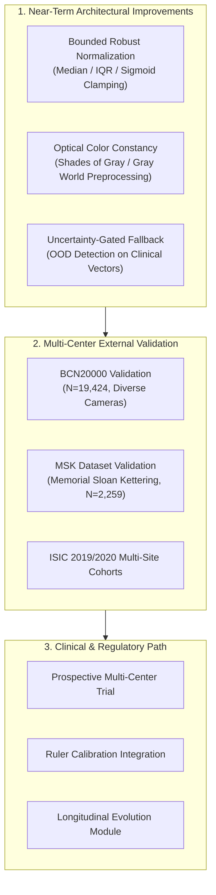

# CEFM Phase 2 — Limitations, Scientific Vulnerabilities, and Future Work

**Project:** Clinical-Expert-Feature-Modulated (CEFM) Multimodal Skin Lesion Classification  
**Phase:** Phase 2 Dual-Scale Fusion Research  
**Document Type:** Research Limitations Analysis, Technical Risk Audit, and Scientific Roadmap  
**Date:** November 7, 2026  
**Status:** COMPLETE  

> [!WARNING]
> **Regulatory and Clinical Disclaimer:**  
> The CEFM software and all associated deep learning models (Phase 1 ViT, Phase 1 Multimodal Fusion, and Phase 2 Challenger Models M1–M7) are **investigational prototypes designed exclusively for computer science research into multimodal fusion architectures**. They have **NOT** been certified as medical devices (under FDA 510(k), PMA, or EU MDR CE-IVD), have **NOT** been validated in prospective clinical trials, and must **NEVER** be used to guide patient diagnosis, biopsy decisions, or clinical management.

---

## 1. Methodological & Dataset Limitations

### 1. External Cohort Sample Size & Statistical Power
- **Limitation:** External validation was conducted on the PH² dataset ($N=200$), containing only **40 melanoma cases** and 160 benign lesions (80 atypical nevi, 80 common nevi).
- **Statistical Consequence:** In a sample of 40 positive cases, each individual misclassification changes observed sensitivity by **$2.5\%$** ($1/40$). 
- **Power Audit:** As established in the Step 8 paired bootstrap audit ($B=2,000$), the statistical power to detect small effect sizes ($\Delta\text{AUC} < 0.02$) is less than $30\%$. Consequently, observed differences between counterfactual variants (e.g., $+0.0039$ for hue zeroing, $+0.0109$ for all-clinical zeroing) cross zero in their 95% confidence intervals and are **not statistically significant** ($p_{\text{fdr}} > 0.50$).

### 2. Single-Center External Validation
- **Limitation:** PH² originates from a single clinical center (Dermatology Service of Pedro Hispano Hospital, Matosinhos, Portugal) using a single acquisition device.
- **Incomplete Generalization:** While internal test performance is high (ROC-AUC: $0.9333$ on HAM10000), evaluating on only one external dataset provides insufficient evidence to claim robust multi-center clinical generalization across diverse patient phototypes (Fitzpatrick I–VI) and clinical environments.

---

## 3. Optical Acquisition & Hardware Domain Shift

### 1. Physical Disparity: Polarized Immersion vs. Multi-Center Training
- **Physical Mechanism:**  
  HAM10000 was collected across multiple centers using various dermatoscopes (predominantly non-polarized and cross-polarized contact systems such as DermLite DL100, DL2, and DL3). In contrast, PH² was captured exclusively with the **Tuebinger Mole Analyzer** system, utilizing a cross-polarized ring illuminator combined with **liquid mineral oil immersion**.
- **Measured Hardware Artefacts:**
  - **Severe Blue Channel Attenuation:** Blue channel pixel intensity dropped by **$-24.6$ px ($-16.5\%$)** in PH² compared to HAM10000.
  - **Amber/Red Ratio Shift:** The red-to-blue channel ratio shifted from $1.21$ in HAM10000 to **$1.60$ in PH² (+32.8%)**.
  - **HSV Hue Distribution Compression:** Mean hue standard deviation collapsed from $0.6076$ in HAM10000 to $0.1829$ in PH² (**$-1.36\sigma$**, Kolmogorov-Smirnov $p = 6.56 \times 10^{-61}$).

---

## 4. Clinical Feature Pipeline Vulnerabilities

### 1. Inactive & Unpopulated Feature Dimensions
- **Audit Finding:** In both training and external evaluation, **9 of the 16 clinical dimensions are constant zeros**:
  - Dimensions 1, 2, 5, 6: Unpopulated sub-metrics resulting from scalar float returns in `extract_abcde_features`.
  - Dimensions 11, 12: Zero-imputed due to absence of millimeter ruler markers in public benchmark images.
  - Dimensions 13, 14, 15: Zero-imputed due to absence of longitudinal follow-up visits in single-timepoint datasets.
- **Consequence:** The 16-D clinical feature vector is effectively reduced to only **5 active signals** (asymmetry, border irregularity, hue std, saturation std, and value std), meaning the clinical encoder operates on a sparse, constrained manifold.

### 2. Z-Score Normalization Instability under Domain Shift
- **Vulnerability:** Standard Z-score normalization:
  $$\tilde{c}_i = \frac{c_i - \mu_{\text{train}, i}}{\sigma_{\text{train}, i}}$$
  assumes external test features share the statistical moments of the training distribution. When physical acquisition differences compress feature variance (such as hue std under liquid immersion), normalized inputs are forced into unmodeled lower tails ($z = -1.36\sigma$).
- **Gate Variance Collapse:** In M6, this shift compressed the clinical modulation gate activation standard deviation by **29x** (from $0.0939$ in validation to $0.0032$ in PH²), causing the gate to become a static multiplier ($\approx 1.50$) rather than an adaptive, image-specific modulator.

---

## 5. Technical Recommendations & Future Research Roadmap

### 1. Robust Tabular Normalization & Clamping
- Replace unconstrained Z-score normalization with **bounded robust scaling** (e.g., median and interquartile range with tanh/sigmoid clamping):
  $$\tilde{c}_i = \tanh\left(\frac{c_i - \text{median}_i}{1.349 \times \text{IQR}_i}\right)$$
- This guarantees that extreme out-of-distribution tabular artifacts cannot push the clinical encoder into saturated or degenerate activation regions.

### 2. Preprocessing Optical Color Constancy
- Incorporate automated **color constancy algorithms** (e.g., Shades-of-Gray or Gray-World color normalization) prior to both ViT feature extraction and HSV color feature computation.
- Neutralizing illumination spectra at the pixel level will prevent device-specific ring lighting and immersion fluids from distorting hue and saturation histograms.

### 3. Uncertainty & Out-of-Distribution Gating
- Deploy an explicit **out-of-distribution (OOD) detector** (e.g., Mahalanobis distance or Energy-based scoring) on the 16-D clinical vector.
- When an input's clinical features deviate by more than $2.5\sigma$ from training statistics, the system should gracefully bypass clinical modulation ($c_{\text{mod}} = 0$) and fall back to purely visual dual-scale inference.

### 4. Large-Scale Multi-Center External Benchmarking
- Expand external validation beyond PH² to major public multi-center repositories:
  - **BCN20000 (Hospital Clínic de Barcelona):** 19,424 dermoscopic images captured with various dermatoscopes and high-resolution cameras.
  - **MSK (Memorial Sloan Kettering):** 2,259 images reflecting independent North American clinical demographics.
  - **ISIC 2020 Challenge Cohort:** Incorporating diverse Fitzpatrick phototypes and primary care acquisition settings.

---

## 6. Regulatory & Deployment Boundaries

1. **Phase 1 Production Status Preserved:**  
   The Phase 1 ViT and multimodal fusion checkpoints remain the sole active defaults. M6 is strictly an experimental challenger model.
2. **Promotion Preconditions:**  
   Under no circumstances should M6 or any dual-scale challenger model be promoted to primary clinical production without:
   - Implementation of bounded clinical feature normalization and color constancy.
   - Comprehensive multi-center external validation on $\ge 5,000$ independent cases across $\ge 3$ distinct clinical hospital systems.
   - Formal institutional review and regulatory qualification.

