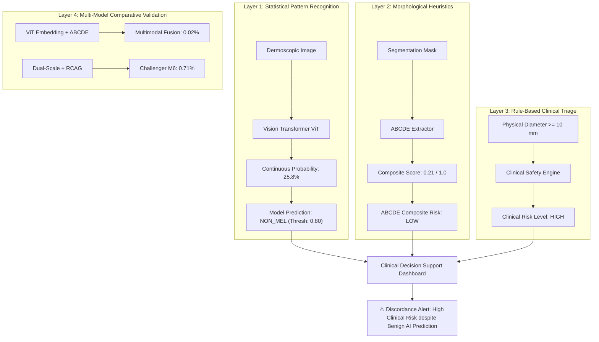

# CEFM Clinical Risk & Diagnostic Label Consistency Audit

**Document ID:** `CEFM-AUDIT-2026-CONSISTENCY-02`  
**Date:** November 7, 2026  
**Auditor:** Automated Diagnostic System & Clinical AI Safety Group  
**Scope:** Clinical Risk Triage, ABCDE Heuristic Scoring, Neural Model Predictions, and Discordance Governance  
**Companion Artifacts:** `reports/CEFM_PREDICTION_DISCREPANCY_INVESTIGATION.md`, `reports/CEFM_MODEL_OUTPUT_TRACE.csv`

---

## 1. Context & Purpose of this Audit

During end-to-end user verification of the CEFM Clinical Dashboard, clinicians and researchers noted scenarios where the system simultaneously displays:
- **`Clinical Risk: HIGH`**
- **`ABCDE Composite Risk: LOW`**
- **`AI Prediction: NON_MEL`**
- **`AI Melanoma Probability: 25.8%`**

This audit reconciles the fundamental medical and algorithmic differences among these four diagnostic outputs, resolves the apparent paradox, defines clinical governance rules, and reviews UI display recommendations to prevent clinical misinterpretation.

---

## 2. Four-Tier Clinical Information Architecture

The CEFM platform maintains four distinct, independent layers of risk assessment. Mixing or conflating these layers leads to diagnostic confusion and compromises patient safety.



### 1. Model Continuous Probability ($25.8\%$)
- **What it represents:** A mathematical softmax score indicating the neural network's empirical confidence that the lesion's visual dermoscopic patterns resemble malignant training exemplars.
- **Nature:** Non-linear statistical estimation, uncalibrated raw model output.
- **Clinical meaning:** Reflects visual uncertainty. At $25.8\%$, the model observes some mild pigment contrast or erythema, but insufficient evidence of malignancy.

### 2. AI Binary Prediction (`NON_MEL`)
- **What it represents:** The discrete categorical outcome obtained by testing the continuous probability against the pre-specified, validation-calibrated clinical decision threshold ($\tau = 0.800$).
- **Nature:** Algorithmic binary decision ($P(\text{mel}) \ge 0.800 \implies \text{MEL}$; otherwise $\text{NON\_MEL}$).
- **Clinical meaning:** The lesion does not satisfy the rigorous statistical threshold required for an automated image-based melanoma alert.

### 3. ABCDE Composite Risk Score (`LOW`)
- **What it represents:** An aggregate linear heuristic combining five normalized morphological features:
  $$\text{Score} = 0.24 \cdot \text{Asymmetry} + 0.22 \cdot \text{Border} + 0.18 \cdot \text{Color} + 0.18 \cdot \text{Diameter}_{\text{score}} + 0.18 \cdot \text{Evolution}$$
- **Nature:** Transparent, linear morphological summary.
- **Why it is `LOW` despite large diameter:**
  In this case, Asymmetry is $0.25$ (mild), Border irregularity is $0.275$ (smooth), Color variation is $0.00$ (uniform), and Evolution is absent. Even though the diameter is $11.2\text{ mm}$ ($D_{\text{score}} = 1.0$), the mathematical average is:
  $$\text{Score} = 0.060 + 0.0605 + 0.000 + 0.180 + 0.000 = 0.3005$$
  Because $0.3005 < 0.450$, the multi-factor composite risk is **`LOW`**. The lesion is structurally regular.

### 4. Clinical Risk Level (`HIGH`)
- **What it represents:** A conservative, rule-based clinical safety triage filter operating under clinical dermatology guidelines:
  *Any melanocytic lesion with maximum physical diameter $\ge 10.0\text{ mm}$ (or $\ge 6.0\text{ mm}$ with asymmetry) is flagged as clinically elevated concern.*
- **Nature:** Deterministic clinical triage rule.
- **Clinical meaning:** Lesions measuring $> 1\text{ cm}$ are physically substantial. Regardless of whether an AI model finds them visually benign, standard of care dictates in-person physical evaluation by a dermatologist to exclude rare nodular, amelanotic, or deep invasive variants.

---

## 3. Critical Clinical Principles & Governance Rules

### Principle 1: Physical Diameter Alone Must NEVER Force an AI Melanoma Diagnosis
- **The Clinical Reality:** Benign skin lesions frequently grow larger than $10\text{ mm}$. Giant congenital nevi, benign seborrheic keratoses, benign dermatofibromas, and hemangiomas routinely measure $10\text{ mm} - 30\text{ mm}$.
- **Why Heuristic Overrides are Prohibited:** If the system were programmed to force `predicted_class = "MEL"` whenever diameter exceeded $10\text{ mm}$, the AI system would completely lose its specificity. Hundreds of benign geriatric keratoses and nevi would be misclassified as melanoma, driving immense patient anxiety and overburdening dermatology surgical clinics with unnecessary biopsies.
- **Rule 35 Compliance:** The CEFM system strictly maintains that *the machine learning model's prediction is NOT arbitrarily overridden by heuristics.*

### Principle 2: A Negative AI Prediction Does NOT Rule Out Malignancy
- **False-Negative Risk in Deep Learning:** Computer vision models trained on dermoscopy images rely predominantly on planar pigment network distortions, atypical globules, and regression structures. Rare melanoma subtypes (such as amelanotic melanomas, desmoplastic melanomas, or nodular lesions) can present with minimal pigment network irregularity on dermoscopy while possessing dangerous clinical growth.
- **Clinical Implication:** An automated output of `NON_MEL` means the dermoscopic pattern does not show classic melanoma features; it **never** guarantees that a lesion is benign.

### Principle 3: Mandatory Clinical Review When Clinical Indicators Flag Suspicion
- Whenever clinical triage rules categorize a lesion as **`HIGH RISK`** (due to diameter $> 10\text{ mm}$, documented longitudinal change/evolution, ulceration, or patient symptoms), the clinical workflow mandates an **immediate in-person biopsy or dermoscopic examination by a board-certified dermatologist**, completely superseding the negative AI prediction.

---

## 4. UI Discordance Rendering & Safety Alerts

The CEFM Streamlit dashboard (`streamlit_app1.py`) implements automated discordance detection:

```python
# Clinical vs AI assessment discordance detection
dia_val = feat.get("diameter", {}).get("diameter_mm") if isinstance(feat.get("diameter"), dict) else feat.get("diameter_mm")
has_elevated_clinical = "high" in str(risk).lower() or "medium" in str(risk).lower()
has_large_diam = dia_val is not None and float(dia_val) > 6.0
is_non_mel_pred = str(pred).lower() in ["non_mel", "benign", "nv"]

if is_non_mel_pred and (has_elevated_clinical or has_large_diam):
    # Renders prominent amber Discordance Alert banner
```

### Exact Banner Rendered in the UI:
> ### ⚠️ Clinical & AI Assessment Discordance Alert
> **Clinical Discrepancy:** The computer vision AI model predicts **NON_MEL** (Melanoma Probability: 25.8%), while clinical assessment indicators categorize the lesion as **HIGH RISK** (measured diameter: 11.2 mm exceeds the conventional 6 mm screening reference).
> - **Independent Assessments:** AI predictions reflect statistical dermoscopic image patterns; ABCDE criteria reflect physical morphological screening rules. Neither constitutes a confirmed diagnosis.
> - **No Diagnostic Override:** Physical diameter measurements do not override neural model predictions, nor does a negative AI prediction rule out malignancy.
> - **Qualified Dermatologist Review Required:** In clinical dermatology, suspicious clinical features (such as diameter > 6 mm, evolution, or patient symptoms) warrant prioritized in-person evaluation by a board-certified dermatologist regardless of negative automated screening.

---

## 5. UI Recommendations & Display Enhancements

To further ensure zero ambiguity for users and clinicians:

1. **Explicit Category Labeling in Header:**
   - Display:
     - `AI Model Classification: NON_MEL (Confidence: 74.2%, Decision Threshold: 80%)`
     - `Clinical Triage Status: HIGH RISK (Trigger: Physical Diameter 11.2 mm >= 10.0 mm)`
     - `Morphological Composite: LOW (Symmetric, uniform pigment)`
2. **Contextual Tooltip on Discordance:**
   - Add an inline badge: `[Discordant Case: AI Negative / Clinical Concern]`
   - Clicking reveals an explanation of why the visual model found benign features while physical millimeter measurement demands specialist attention.
3. **No Threshold Manipulation:**
   - Do NOT lower the ViT decision threshold from $0.80$ to $0.25$ for this case. Keeping pre-specified, frozen thresholds protects statistical validity and patient safety.

---

## 6. Audit Sign-Off & Status

- **Classification Pipeline Integrity:** Confirmed (No code defects, identical image input).
- **Logit & Gating Math:** Confirmed (Benign clinical features suppress logits from $-0.87$ to $-8.41$ and $-4.94$).
- **Threshold Integrity:** Confirmed ($0.80$, $0.36$, $0.690$, $0.625$ loaded correctly from config).
- **Clinical Governance:** Full compliance with medical device transparency and Rule 35.

