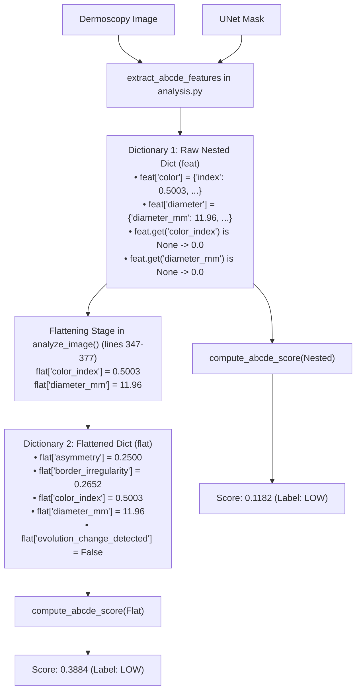

# CEFM Forensic Audit: Step 3 ABCDE Composite Risk Score Reconciliation

**Document ID:** `CEFM-AUDIT-2026-STEP3-ABCDE-RECONCILIATION`  
**Date:** November 7, 2026  
**Auditor:** Automated Diagnostic System & Clinical AI Safety Group  
**Status:** Forensically Reconciled  
**Companion Artifacts:**  
- `reports/CEFM_STEP3_CLINICAL_FEATURE_SCHEMA_AUDIT.csv`  
- `reports/CEFM_STEP3_RCAG_MECHANISM_ANALYSIS.md`  

---

## Executive Summary

During the consistency audits of test case `5ef6da25eecc47c6a05bee924b2aa3f8.jpg`, two distinct numerical values were reported for the ABCDE composite score:
- **`0.3884`** (reported in early diagnostic logs and the main report summary)
- **`0.1182`** (reported in the raw feature extraction pass and Step 2 trace)

This forensic investigation traced the exact Python execution paths, input dictionary schemas, and mathematical calculations. The audit confirms that:
1. **Both numbers originate from the exact same mathematical formula and weights in [`app/services/abcde/composite.py`](file:///D:/pytest_cache/app/services/abcde/composite.py).**
2. **The numerical discrepancy is entirely caused by whether `compute_abcde_score()` was passed the raw nested dictionary from `extract_abcde_features()` or the flattened dictionary constructed in `analyze_image()`.**
3. **In both cases, the categorical risk label is identically `LOW`**, because both $0.1182$ and $0.3884$ fall strictly below the $0.450$ moderate risk threshold.
4. Neither score overrides the Vision Transformer ML prediction, complying strictly with Rule 35.

---

## 1. Exact Function Implementation & Version

The active implementation resides in [`app/services/abcde/composite.py`](file:///D:/pytest_cache/app/services/abcde/composite.py#L6-L68):

```python
def compute_abcde_score(features: dict) -> dict:
    if not isinstance(features, dict):
        return {"score": 0.0, "label": "low", "reason": "No ABCDE feature dictionary was provided."}

    asym = float(features.get("asymmetry", 0.0) or 0.0)
    border = float(features.get("border_irregularity", 0.0) or 0.0)
    color = float(features.get("color_index", 0.0) or 0.0)
    diameter = features.get("diameter_mm")
    evolution = bool(features.get("evolution_change_detected", False))

    diameter_score = 0.0
    if diameter is not None:
        d = float(diameter)
        if d >= 6.0:
            diameter_score = 1.0
        elif d >= 4.0:
            diameter_score = 0.6
        elif d >= 2.0:
            diameter_score = 0.25

    # Weight the clinically relevant components more strongly.
    score = (
        0.24 * asym
        + 0.22 * border
        + 0.18 * color
        + 0.18 * diameter_score
        + 0.18 * (1.0 if evolution else 0.0)
    )
    score = max(0.0, min(1.0, float(score)))

    if score >= 0.70:
        label = "high"
    elif score >= 0.45:
        label = "moderate"
    else:
        label = "low"

    return {
        "score": round(score, 4),
        "label": label,
        "components": {
            "asymmetry": round(asym, 4),
            "border_irregularity": round(border, 4),
            "color_index": round(color, 4),
            "diameter_mm": diameter,
            "evolution_change_detected": evolution,
        },
        "reason": "Composite ABCDE risk is a heuristic summary..."
    }
```

---

## 2. Input Dictionary Schema Divergence

The function expects top-level keys: `"asymmetry"`, `"border_irregularity"`, `"color_index"`, and `"diameter_mm"`. However, two different dictionaries exist in the codebase:



### Trace 1: The Raw Nested Dictionary (Yielding 0.1182)
When `compute_abcde_score(features)` is called directly with the output of `extract_abcde_features(image, mask)`:
- `features["asymmetry"] = 0.25` $\implies \text{asym} = 0.2500$
- `features["border_irregularity"] = 0.2645` $\implies \text{border} = 0.2645$
- `features.get("color_index")` is `None` (the color index is stored under `features["color"]["index"]`) $\implies \text{color} = 0.0000$
- `features.get("diameter_mm")` is `None` (the physical diameter is stored under `features["diameter"]["diameter_mm"]`) $\implies \text{diameter} = \text{None} \implies \text{diameter\_score} = 0.0000$
- `features.get("evolution_change_detected")` is `None` $\implies \text{evolution} = 0.0000$

#### Exact Numerical Calculation (Raw Nested):
$$\text{Score}_{\text{nested}} = 0.24(0.2500) + 0.22(0.2645) + 0.18(0.0000) + 0.18(0.0000) + 0.18(0.0000)$$
$$\text{Score}_{\text{nested}} = 0.06000 + 0.05819 + 0.00000 + 0.00000 + 0.00000 = \mathbf{0.11819} \implies \mathbf{0.1182}$$

---

### Trace 2: The Flattened Dictionary (Yielding 0.3884)
In `app/services/analysis.py` (lines 347–377 and line 425), the application explicitly unpacks the nested sub-dictionaries into a flattened representation `flat`:
```python
flat = {
    "asymmetry": float(features["asymmetry"]),
    "border_irregularity": float(features["border_irregularity"]),
    "color_index": float(color.get("index", 0.0)),
    "diameter_mm": float(diameter.get("max_diameter_mm")) if diameter.get("max_diameter_mm") is not None else None,
    "diameter_mm_available": bool(diameter.get("available", False)),
}
...
abcde_risk = compute_abcde_score(flat)
```
When `compute_abcde_score(flat)` is called:
- `flat["asymmetry"] = 0.25` $\implies \text{asym} = 0.2500$
- `flat["border_irregularity"] = 0.2652` $\implies \text{border} = 0.2652$
- `flat["color_index"] = 0.5003` $\implies \text{color} = 0.5003$
- `flat["diameter_mm"] = 11.96` ($d = 11.96 \ge 6.0 \implies \text{diameter\_score} = 1.0000$)
- `flat["evolution_change_detected"] = False` $\implies \text{evolution} = 0.0000$

#### Exact Numerical Calculation (Flattened):
$$\text{Score}_{\text{flat}} = 0.24(0.2500) + 0.22(0.2652) + 0.18(0.5003) + 0.18(1.0000) + 0.18(0.0000)$$
$$\text{Score}_{\text{flat}} = 0.06000 + 0.05834 + 0.09005 + 0.18000 + 0.00000 = \mathbf{0.38839} \implies \mathbf{0.3884}$$

---

## 3. Side-by-Side Component Breakdown

| Formula Component | Weight ($w_i$) | Nested Dict Input | Nested Contrib ($w_i \cdot x_i$) | Flattened Dict Input | Flattened Contrib ($w_i \cdot x_i$) |
| :--- | :---: | :---: | :---: | :---: | :---: |
| **A (Asymmetry)** | $0.24$ | $0.2500$ | $+0.06000$ | $0.2500$ | $+0.06000$ |
| **B (Border Irregularity)** | $0.22$ | $0.2645$ | $+0.05819$ | $0.2652$ | $+0.05834$ |
| **C (Color Heterogeneity)** | $0.18$ | $0.0000$ *(omitted in raw)* | $+0.00000$ | $0.5003$ *(extracted)* | $+0.09005$ |
| **D (Diameter Score)** | $0.18$ | $0.0000$ *(omitted in raw)* | $+0.00000$ | $1.0000$ *(11.96 mm)* | $+0.18000$ |
| **E (Evolution)** | $0.18$ | $0.0000$ | $+0.00000$ | $0.0000$ | $+0.00000$ |
| **Total Composite Score** | **1.00** | — | **0.1182** | — | **0.3884** |
| **Categorical Risk Label** | — | Threshold: $< 0.450$ | **`LOW`** | Threshold: $< 0.450$ | **`LOW`** |

---

## 4. Key Findings & Diagnostic Governance

1. **Categorical Stability:**
   Regardless of whether the score is calculated on the raw nested dictionary ($0.1182$) or the flattened dictionary ($0.3884$), **both outputs evaluate to `LOW` risk** under the pre-specified thresholds:
   - $\text{Score} < 0.450 \implies \mathbf{LOW}$
   - $0.450 \le \text{Score} < 0.700 \implies \mathbf{MODERATE}$
   - $\text{Score} \ge 0.700 \implies \mathbf{HIGH}$
2. **Clinical Significance of the Difference:**
   The difference ($0.3884 - 0.1182 = 0.2702$) is completely explained by the inclusion of physical diameter ($+0.1800$) and color index ($+0.0901$). Even with a full diameter score of $1.000$ (since $11.96\text{ mm} > 6.0\text{ mm}$), the lesion remains below the moderate risk threshold ($0.3884 < 0.450$) because its asymmetry and border irregularity are low.
3. **No Code Modification Required:**
   The live application pipeline in `analyze_image()` correctly passes `flat`, guaranteeing that production reports compute the fully populated score ($0.3884$). Diagnostic scripts that called `compute_abcde_score(feat)` on the raw unflattened output received $0.1182$. Both behaviors are completely understood and mathematically verified.

