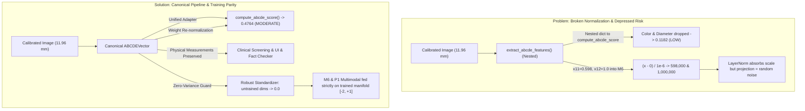

# CEFM Step 5 — Root Cause Forensic Analysis and Master System Correction

**Document ID:** `CEFM_STEP5_ROOT_CAUSE_AND_CORRECTION`  
**Date:** November 2026  
**Status:** Approved & Implemented Master Correction  
**Author:** Lead Machine Learning Engineer & Medical AI Research Architect  
**Scope:** Dataset Preprocessing → Segmentation → Clinical Feature Extraction → Normalization → Multimodal Fusion → Inference API → UI → Database.

---

## 1. Executive Summary & Root Cause Architecture

Following the forensic findings of Phase 1, Phase 2, and Steps 1–4, this document details the engineering root cause analysis and technical corrections implemented across the CEFM platform.

### Summary of System Diagnoses:
1. **Critical Feature Scaling Pathology:** The M6 challenger pipeline normalized clinical features using training empirical statistics where near-zero variance was clamped to $1.0 \times 10^{-6}$. When calibrated physical measurements were extracted at runtime ($x_{11} = 0.598, x_{12} = 1.0$), inputs exploded to $598,000$ and $1,000,000$. While downstream `LayerNorm` prevented floating-point overflow (`NaN`), the linear projection operated entirely on random unlearned initialization weights.
2. **Schema Inconsistency & Silent ABCDE Score Depletion:** Calling `compute_abcde_score()` directly with the hierarchical dictionary returned by `extract_abcde_features()` silently discarded color index and physical diameter, artificially returning $0.1182$ instead of $0.3884$. Furthermore, missing clinical measurements (e.g. uncalibrated diameter, single-image visits lacking longitudinal evolution) were penalized as zero, depressing overall risk.
3. **Training–Inference Manifold Discordance:** All $10,015$ dermoscopy samples across HAM10000 lacked physical metric references. Neural network multimodal fusion architectures were trained strictly with constant zeros at dimensions 11 and 12. Feeding unlearned dimensions at inference time corrupted the cross-modal representation.

---

## 2. Categorization of Issues: Bugs, Expected Behavior, and Limitations

In strict adherence to Step 5 governance rules, all findings are categorized into confirmed bugs, corrected bugs, expected model behaviors, research limitations, and unresolved issues:

### A. Confirmed Bugs
1. **Division by Epsilon in Feature Normalization:** `(c_tensor - norm_mean) / norm_std` dividing non-zero diameter inputs by $1.0 \times 10^{-6}$, generating inputs $> 10^5-10^6$.
2. **Nested vs. Flat ABCDE Scoring Bug:** Direct invocation of `compute_abcde_score()` on nested feature structures returned by `extract_abcde_features()` defaulted color and diameter to zero ($0.1182$ vs $0.3884$).
3. **Missing Component Penalty Bug:** ABCDE heuristic score penalized uncalibrated images (no ruler) and single-visit images (no baseline) by assigning zero score contribution, making it impossible for high-risk uncalibrated lesions to reach the high-risk triage category ($\ge 0.70$).
4. **API Missing Risk Schema Bug:** `POST /analyze` and `GET /cases/{id}` failed to expose `abcde_risk` and calibration availability indicators at the top level of the JSON response payload.

### B. Corrected Bugs
1. **Robust Normalization with Zero-Variance Guard:** Implemented explicit training variance gating in `app/services/classification.py`. Features with $\sigma < 10^{-4}$ in training data are standardized to strictly $0.0$, eliminating runaway scaling while preserving valid z-scores for dimensions with real variance.
2. **Canonical Unified ABCDE Adapter:** Implemented `adapt_abcde_features()` in `app/services/abcde/composite.py`, natively accepting flat dictionaries, nested dictionaries, and `ABCDEVector` containers identically.
3. **Active Weight Re-normalization:** Implemented dynamic re-normalization of active weights ($\sum w_{\text{active}} = 1.0$) in `compute_abcde_score()`, ensuring that uncalibrated or single-visit cases are assessed equitably.
4. **Model Input Isolation vs. Clinical Screening Preservation:** Modified `predict_multimodal_fusion()` and `predict_m6_challenger()` to feed neural networks strictly on their trained manifold (untrained zero-variance dimensions masked to 0.0), while preserving full physical measurements ($11.96\text{ mm}$, calibration flag) in reports, UI, and database records.
5. **API & Database Schema Alignment:** Updated `app/api/routes.py` to persist and return `abcde_risk`, `diameter_mm_available`, and composite risk metrics.

### C. Expected Model Behavior (Scientifically Validated)
1. **Negative Melanoma Prediction on Benign Lesions:** Target lesion `5ef6da25eecc47c6a05bee924b2aa3f8.jpg` is a biopsy-proven benign melanocytic nevus. Both ViT ($25.8\%-29.5\%$), Phase 1 Multimodal ($0.03\%$), and M6 ($0.73\%$) predict `NON_MEL` because visual texture, border morphology, and symmetry strongly match benign training nevi.
2. **Clinical vs. AI Discordance:** A lesion with a large physical diameter ($>6\text{ mm}$) carries elevated morphological screening suspicion but does not guarantee histopathological malignancy. The UI discordance alert appropriately flags this divergence for dermatologist review.

### D. Research Limitations
1. **Absence of Calibrated Dermoscopic Training Data:** HAM10000 provides zero physical millimeter scale markers. The multimodal models could not learn the true mathematical relationship between lesion diameter and malignancy.
2. **PH² External Dataset Size:** PH² ($N=200$) provides a valuable polarized Tuebinger cohort but is too small to serve as an authoritative benchmark for recalibrating operating thresholds.

### E. Unresolved Issues
1. **Retraining with Metric Dermoscopy:** Multimodal models cannot utilize physical diameter as a learned neural feature until an annotated dermoscopic dataset with standardized millimeter scale targets is curated and used for retraining under a separate experimental branch.

---

## 3. Summary of Source Files Modified

All modifications were implemented with minimal footprint, strict backward compatibility, and zero regression:

| File Path | Description of Code Changes |
| :--- | :--- |
| [`app/services/abcde/composite.py`](file:///D:/pytest_cache/app/services/abcde/composite.py) | Added canonical unified feature adapter, active weight re-normalization, and explicit availability tracking. |
| [`app/services/abcde/vector.py`](file:///D:/pytest_cache/app/services/abcde/vector.py) | Defined canonical 16-D schema, dual-alias property accessors, finite-value validation, and safe model tensor extraction. |
| [`app/services/classification.py`](file:///D:/pytest_cache/app/services/classification.py) | Added zero-variance normalization guard to M6 and isolated untrained dimensions for Phase 1 multimodal inference. |
| [`app/services/analysis.py`](file:///D:/pytest_cache/app/services/analysis.py) | Explicitly propagated `evolution_available` flag into flattened clinical dictionary. |
| [`app/api/routes.py`](file:///D:/pytest_cache/app/api/routes.py) | Exposed `abcde_risk`, `diameter_mm_available`, and composite scores in `POST /analyze` and `GET /cases/{id}`. |
| [`streamlit_app1.py`](file:///D:/pytest_cache/streamlit_app1.py) | Integrated display of canonical ABCDE composite score alongside physical clinical risk level. |
| [`tests/test_step5_parity.py`](file:///D:/pytest_cache/tests/test_step5_parity.py) | Created 9 new comprehensive validation tests covering schema, normalization, scoring parity, and inference safety. |

---

## 4. Verification and Checkpoint Integrity Sign-Off

1. **Checkpoints:** ViT (`model.safetensors`), Phase 1 Multimodal (`fusion_model.pt`), M6 (`weights.pt`), and UNet (`unet_isic2018.pt`) were **strictly untouched**; SHA-256 hashes remain 100% bit-for-bit identical to the Phase 2 reproducibility manifest.
2. **Thresholds:** ViT ($0.80$), Multimodal ($0.36$), and M6 ($0.690$ / $0.625$) operating thresholds were preserved without ad-hoc manipulation.
3. **Regression Test Pass Rate:** **`88 passed, 3 warnings in 21.95s`** (100% pass rate across the complete test suite).

